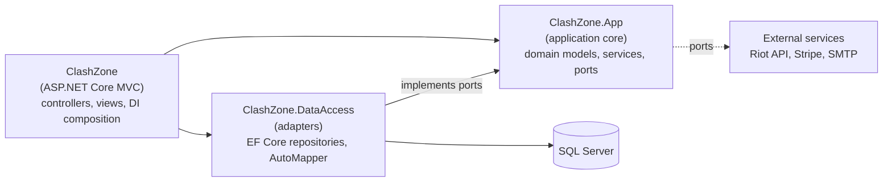

# Clash Zone

**E-sports tournament and league management platform built with ASP.NET Core (.NET 9).**

Clash Zone automates the whole lifecycle of an e-sports competition: player and team registration, roster confirmation, bracket generation, match results, statistics and rankings. It supports **Counter-Strike 2** and **League of Legends** (with real match data from the Riot Games API), seasonal leagues, an in-app currency shop and premium subscriptions paid through Stripe.

The project was developed as my engineering thesis at the Polish-Japanese Academy of Information Technology (PJATK), *Business Applications* specialization, 2026.


---

## Features

- **Tournaments**: create and configure tournaments (game, format, start date, team limit, rules, prize pool); players browse and join.
- **Automatic brackets**: single-elimination bracket generation, including BYEs for incomplete rounds.
- **Teams**: team creation and joining, player readiness (`IsReady`) and roster confirmation by the captain. Only confirmed teams enter the bracket.
- **Multi-game support**: a central `GameCatalog` defines titles, allowed formats (CS2: 1v1, 2v2, 5v5; LoL: 1v1, 5v5), team sizes and score units.
- **Riot Games API integration**: real League of Legends match results (Account-V1, Match-V5). Players link their Riot ID (`Name#TAG`) in their profile.
- **Seasonal leagues**: league seasons with standings.
- **Statistics and rankings**: per-player match stats and a K/D-based ranking with pagination.
- **ClashCoins shop**: in-app currency wallet, product shop and order handling.
- **Premium subscriptions**: Stripe Checkout payments.
- **Roles and admin panel**: Player / Organizer / Admin roles (ASP.NET Core Identity), user management (roles, bans), product and order management.
- **Notifications**: email notifications over SMTP (MailKit).

## Tech stack

| Area | Technologies |
| --- | --- |
| Backend | C#, .NET 9, ASP.NET Core MVC, ASP.NET Core Identity |
| Data | Entity Framework Core 9 (code-first migrations), Microsoft SQL Server, AutoMapper |
| Integrations | Riot Games API (typed `HttpClient`, retry on HTTP 429), Stripe.net, MailKit |
| Frontend | Razor views, Bootstrap 5, jQuery, jQuery Validation |
| Testing | xUnit, Moq, EF Core InMemory, Playwright (NUnit) |
| Tooling | Docker, docker-compose, Swagger (Swashbuckle) |

## Architecture

The application started as a classic layered design (*controller → service → EF Core repository*) and was refactored into a **hexagonal architecture (ports and adapters)**. The main goal was to invert dependencies: infrastructure now depends on the application core, not the other way around.



- **`ClashZone.App`** is the core. It holds domain models (`TournamentDomain`, `TeamDomain`, ...), services and **ports**: repository interfaces (`ITournamentsRepository`, `IMatchesRepository`, `ICoinWalletRepository`, ...) and game integration interfaces (`IRiotApiClient`, `IRiotMatchService`). It references no other project in the solution.
- **`ClashZone.DataAccess`** contains the **adapters**: EF Core implementations of the repository ports. AutoMapper profiles translate database entities into domain objects, so the core never sees EF Core types.
- **`ClashZone`** (web) is only the composition root: `Program.cs` registers adapters under their ports, and controllers work exclusively with service interfaces and domain models.

```csharp
builder.Services.AddScoped<ITournamentsRepository, TournamentsRepository>();
builder.Services.AddScoped<ICoinWalletRepository, CoinWalletRepository>();
builder.Services.AddScoped<ITournamentService, TournamentService>();
builder.Services.AddHttpClient<IRiotApiClient, RiotApiClient>(client =>
{
    client.BaseAddress = new Uri(riotOptions.RegionalHost);
    if (riotOptions.IsConfigured)
        client.DefaultRequestHeaders.Add("X-Riot-Token", riotOptions.ApiKey);
});
```

Benefits: any adapter (for example the match data provider) can be replaced without touching domain logic, and unit tests mock ports instead of a database context.

### Project structure

```
ClashZone/               ASP.NET Core MVC web app (controllers, views, Program.cs)
ClashZone.App/           Application core: domain, services, ports
DataAccess/              Adapters: EF Core DbContext, repositories, migrations, AutoMapper profiles
ClashZone.Tests/         Unit tests (xUnit, Moq, EF Core InMemory)
ClashZone.E2E.Tests/     End-to-end tests (Playwright)
```

## Getting started

### Prerequisites

- [.NET 9 SDK](https://dotnet.microsoft.com/download)
- SQL Server (Express, LocalDB or Docker)

### Run locally

1. Set the `DefaultConnection` connection string in `ClashZone/appsettings.json`, for example LocalDB:
   ```
   Server=(localdb)\MSSQLLocalDB;Database=CLASHZONE;Trusted_Connection=True;TrustServerCertificate=true
   ```
2. Run the app:
   ```bash
   dotnet run --project ClashZone/ClashZone.csproj
   ```
3. Open http://localhost:5005

On first start the app creates the database, applies all EF Core migrations and seeds sample data (roles, an admin account, 110 test players, tournaments, a league and shop products). Seeding is idempotent.

### Run with Docker

See [README-DOCKER.md](README-DOCKER.md).

### Optional configuration

External integrations are optional; the app runs without them and the related features are simply disabled. Use [User Secrets](https://learn.microsoft.com/aspnet/core/security/app-secrets) or environment variables rather than committing keys:

```bash
cd ClashZone
dotnet user-secrets set "Stripe:SecretKey" "sk_test_..."
dotnet user-secrets set "Riot:ApiKey" "RGAPI-..."
dotnet user-secrets set "Smtp:Password" "<app-password>"
```

### Demo accounts (development only)

| Role | Email | Password |
| --- | --- | --- |
| Admin | `admin@clashzone.local` | `Admin#123` |
| Player | `user1@clashzone.local` … `user110@clashzone.local` | `User#123` |

## Testing

The unit test suite (24 test classes covering services and controllers) follows the Arrange-Act-Assert pattern. Moq mocks the core ports and EF Core InMemory replaces SQL Server where database behavior matters (for example ranking sorting and pagination). Controllers for brackets, payments, rankings and user administration are covered.

```bash
# Unit tests: no database or running app required
dotnet test ClashZone.Tests/ClashZone.Tests.csproj

# End-to-end tests: require the running app, a database and Playwright browsers
dotnet build ClashZone.E2E.Tests/ClashZone.E2E.Tests.csproj
pwsh ClashZone.E2E.Tests/bin/Debug/net9.0/playwright.ps1 install
dotnet test ClashZone.E2E.Tests/ClashZone.E2E.Tests.csproj
```

## Roadmap

- Extract high-traffic contexts (Wallet/Shop, Matches/Stats) into separate services.
- Real-time bracket and match updates.
- More tournament formats (double elimination, Swiss).

## Author

**Jan Boroń** · [GitHub](https://github.com/JanekBoron)
